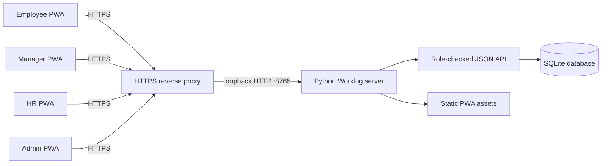

# System overview and architecture

## Components

- **Desktop client:** HTML/CSS/JavaScript PWA installable from Edge or Chrome. All roles install the same client; the authenticated profile determines permissions.
- **Server:** Python standard-library `ThreadingHTTPServer`; serves the PWA and JSON API on one origin.
- **Database:** SQLite, default `data/worklog.sqlite3`; change with `WORKLOG_DB_PATH`.
- **HTTPS proxy:** Caddy or equivalent terminates TLS and forwards to `127.0.0.1:8765`.
- **Service worker:** caches the shell only. `/api/` requests and user data are not cached offline.

## Data flow

1. Admin creates accounts and assigns role, team, and manager relationship.
2. User signs in; the server verifies the password hash and creates a session.
3. Each API operation checks the session, role, and direct-report scope.
4. Managers assign tasks, record a 1–5 rating plus written feedback, and explicitly share it.
5. Employees see own tasks and shared feedback and may submit correction requests.
6. HR reviews shared feedback and records an independent grade, written note, and disposition.
7. Material changes are recorded in the audit table.

## Deployment topology and limits

The application defaults to loopback. The reverse proxy publishes the organization HTTPS hostname. PWA and API must remain same-origin. One organization per installation; no SSO, HRIS write-back, notifications, attachments, automated retention, or high-availability guarantee. SQLite is for a controlled pilot; assess managed database and operational requirements before scale-out.
